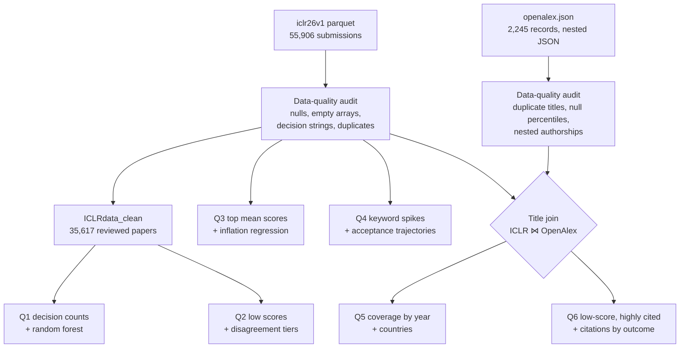

# Big Data Analysis of ICLR Submissions with PySpark

**Six questions for the ICLR Programme Committee, answered with PySpark and Spark MLlib on Databricks across 55,906 submissions and an OpenAlex citation scrape.**


MSc Data Science, University of Sheffield (2026) · Module: Big Data Analytics · **Awarded 87% (Distinction)** · Author: **Cailey Coghlan**

📓 [View the notebook](notebooks/iclr_big_data_analysis.ipynb) · 📄 [Read the full report (PDF)](docs/report.pdf)

---

## Project summary

### The problem
The International Conference on Learning Representations (ICLR) is one of the largest machine-learning conferences. Its submissions have grown roughly 40-fold since 2017, which puts heavy pressure on its review process. The Programme Committee needs evidence on a handful of questions:

- Is the review process consistent?
- Are scores being inflated over time?
- Which research topics are emerging?
- Where do submissions come from?
- Does the process ever reject work that goes on to be influential?

### What I did
I built the full analysis in **PySpark on Databricks** across two datasets:

- **ICLR submissions (2017–2026):** 55,906 papers with titles, abstracts, reviewer score arrays, decisions and keywords
- **OpenAlex:** a 2,245-record scrape with citation counts, citation percentiles and author institutions

The work covered four stages:

1. **Auditing data quality.** I checked duplicates, empty decisions, empty and null score arrays, and inconsistent decision strings. I found that 19,673 rows were unreviewed 2026 submissions and excluded them where a decision or scores were needed, leaving 35,617 fully reviewed papers.
2. **Answering six core questions,** each with its own extension. This used Spark's higher-order array functions, exploded nested arrays, self-joins on consecutive years, window functions, approximate quantiles, and a cross-dataset join on normalised titles.
3. **Building two Spark MLlib models.**
   - A **random forest** that predicts acceptance from reviewer-score features, tuned with 3-fold `CrossValidator`.
   - **Linear regression** that tests whether scores have inflated over time.
4. **Validating the code.** I checked the core-question code against two earlier releases of the dataset (iclr24v2 and iclr25v2), and it reproduced their reference outputs.

### What I found
- **Reviewer scores almost fully explain acceptance.** The random forest predicts the decision on unseen papers with **AUC 0.962** and **90% accuracy**. Mean and minimum score account for **92.5%** of its predictive power; panel size and reviewer disagreement barely matter.
- **One in five decided submissions is withdrawn** (7,594 of 36,233). That's a large review burden on papers that never reach a decision.
- **There's no evidence of score inflation.** Submission year explains essentially none of the variation in scores (R² ≈ 0), and accepted papers' scores are flat (slope −0.0003 per year).
- **Disagreement explains accepted papers with low scores.** Almost half of accepted papers from high-disagreement panels had at least one score below 5 (49.3%), compared with under 1% from low-disagreement panels.
- **Research topics are mostly stable.** Only four keywords jumped from fewer than 5 to more than 50 papers in a year. Three of them, all in 2026, point to a shift towards reasoning: *test-time scaling*, *large reasoning models* and *spatial reasoning*.
- **Some rejected papers became highly cited.** Thirteen low-scoring submissions reached the **95th citation percentile**, including one with **763 citations** and a mean score of 4.0. Among low-scoring papers, rejected ones averaged more citations than accepted ones (56 vs 40).

### Why it matters
For the committee, the results point to five recommendations:

- **Tighten desk rejection,** or screen early for likely withdrawals, to protect reviewer time.
- **Add specialist reviewers** in high-disagreement research areas.
- **Check reviewer expertise** for the fast-emerging reasoning topics.
- **Do outreach** to under-represented countries.
- **Flag low-scoring papers for a second look,** since scores predict acceptance far better than they predict later impact.

The workflow itself is reusable: change one path setting and the whole notebook runs on a new dataset release.

---

## Key results

| Question | Core answer | Extension |
|---|---|---|
| **Q1.** How many papers were accepted, rejected or withdrawn? | 11,349 accepted · 17,290 rejected · 7,594 withdrawn | Random forest predicts acceptance from scores: AUC 0.962, accuracy 0.903 |
| **Q2.** How many accepted papers had at least one score below 5? | 1,596 of 11,349 (about 1 in 7) | Low scores concentrate in high-disagreement panels; acceptance falls to 25.4% for them |
| **Q3.** Which 10 papers have the highest mean score? | Top paper scored a perfect 10.0; 8 of the top 10 are from 2025 | No score inflation: R² ≈ 0 for all, accepted and rejected papers |
| **Q4.** Which keywords spiked from < 5 to > 50 papers? | *test-time scaling* (3 → 87), *llm* (4 → 76), *large reasoning models* (1 → 57), *spatial reasoning* (3 → 57) | *llm* acceptance fell from 50% to 25% in its spike year, then recovered to 30% |
| **Q5.** How many ICLR papers have OpenAlex records, by year? | 1,593 matched (2.8%); coverage collapses after 2021 | US authors on 880 matched papers, more than the next four countries combined |
| **Q6.** Which low-scoring papers reached the 95th citation percentile? | 13 papers, all from 2017–2020 | Rejected low scorers averaged 56 citations vs 40 for accepted ones |

### Random forest acceptance model (Q1 extension)

| | Predicted: not accepted | Predicted: accepted |
|---|---|---|
| **Actual: not accepted** | 4,532 | 298 |
| **Actual: accepted** | 383 | 1,815 |

- **Features:** five per paper, all built from the score array: mean, minimum, maximum, number of reviewers and score standard deviation.
- **Labels:** accepted vs not accepted. Withdrawn papers count as not accepted.
- **Split:** stratified 80/20 train/test.
- **Tuning:** 3-fold `CrossValidator` over tree depth (5 or 10) with 100 trees, optimising AUC. The best depth was 10.
- **Errors:** the model missed 17% of accepted papers. These are cases where scores alone can't explain the decision, so the rebuttal or reviewer discussion probably mattered.

### Low-scoring papers that became highly cited (Q6)

| Paper | Year | Mean score | Citations |
|---|---|---|---|
| Structured Sequence Modeling with Graph Convolutional Recurrent Networks | 2017 | 4.0 | 763 |
| Visualizing the Loss Landscape of Neural Nets | 2018 | 4.7 | 514 |
| GradNorm: Gradient Normalization for Adaptive Loss Balancing in Deep Multitask Networks | 2018 | 4.7 | 313 |
| Reinforcement and Imitation Learning for Diverse Visuomotor Skills | 2018 | 4.7 | 209 |
| Fair Resource Allocation in Federated Learning | 2020 | 4.0 | 132 |

*All 13 papers are listed in [`results/q6_low_score_highly_cited.csv`](results/q6_low_score_highly_cited.csv).*

---

## How the analysis works



### PySpark techniques used

- **Higher-order array functions,** so array columns are never exploded unnecessarily:
  - `F.aggregate` computes the mean and standard deviation of each paper's score array in place.
  - `F.exists` flags any score below 5 without duplicating rows.
  - `F.array_min` and `F.array_max` give the score range.
- **Nested data:**
  - A **double `explode`** unpacks OpenAlex `authorships` and then each author's `countries`, giving a geographic breakdown.
  - `multiLine` JSON parsing reads the single-array OpenAlex file.
- **Self-join on consecutive years** (`year_prev + 1 == year_next`) finds keyword spikes year on year.
- **Window functions:**
  - deduplicating OpenAlex titles, keeping the record with the highest citation percentile
  - keeping only each keyword's first spike
- **`approxQuantile`** sets data-driven thresholds for the reviewer-disagreement tiers.
- **Regex classification:** a case-insensitive `rlike` pattern handles inconsistent decision strings such as *"Accept (Talk)"* and *"Accept (talk)"*. The same rule is reused in every question.
- **Spark MLlib:** `VectorAssembler`, a Pearson `Correlation` matrix to check multicollinearity, `RandomForestClassifier` with `CrossValidator` and `ParamGridBuilder`, `LinearRegression`, and binary-classification and regression evaluators.

---

## Limitations and next steps

- **Scores and decisions are linked by design.** The random forest shows that decisions are *consistent with* reviewer scores, which is what the committee uses to decide. It can't show that scores measure true merit. Q6 suggests they don't always.
- **The country analysis is a biased sample.** Matched acceptance rates for the top 10 countries (60–90%) are far above ICLR's overall 31%, which suggests the OpenAlex scrape is skewed towards papers that were later published. That makes it unsuitable for drawing conclusions about geographic bias. Author affiliations from OpenReview would give an unbiased sample.
- **Title matching misses papers.** With no shared identifier, papers are joined on title alone. Small differences in punctuation or wording cause missed matches, so the 2.8% match rate and the 13 papers in Q6 are minimum estimates.
- **2026 is mostly unreviewed.** The 19,673 unreviewed 2026 submissions are excluded wherever decisions or scores are needed. So 2026 acceptance rates, such as those in the Q4 trajectories, are based on very few papers.
- **Category choices:**
  - *Invite to Workshop Track* is counted as accepted.
  - Withdrawn papers are grouped with rejected ones for modelling.
  - Both choices are applied consistently, and both are documented assumptions in the report.
- **Next steps:**
  - Widen the random forest's tuning grid. The best depth, 10, was at the edge of the grid.
  - Group reviewer disagreement by research topic.
  - Bring in citation data from Semantic Scholar, so a model can predict which low-scoring papers will become highly cited.

---

## Repository structure

```
iclr-submissions-big-data-analysis/
├── README.md                          # this page
├── notebooks/
│   └── iclr_big_data_analysis.ipynb   # full PySpark analysis, with saved outputs
├── data/
│   ├── iclr26v1.parquet               # ICLR submissions (55,906 papers)
│   └── openalex.json.zip              # OpenAlex scrape (unzips to openalex.json)
├── results/                           # every result table, as CSV
└── docs/
    ├── report.pdf                     # the full report
    └── FILE_GUIDE.md                  # what every file is
```

**Guide to every file:** [docs/FILE_GUIDE.md](docs/FILE_GUIDE.md)

---

## How to run

The notebook opens directly on GitHub, with every output already saved, so you can read the whole analysis without running anything. To rerun it:

1. **Get the data** from this repository's `data` folder:
   - `iclr26v1.parquet` holds the 55,906 ICLR submissions. It's also available from the [Berens lab ICLR dataset](https://github.com/berenslab/iclr-dataset/tree/main/data).
   - Unzip `openalex.json.zip` to get `openalex.json`.
2. **Upload them to Databricks.** In your workspace, go to **Catalog**, create a **Volume**, and upload `iclr26v1.parquet` and `openalex.json` into it.
3. **Import the notebook.** Go to **Workspace → Import** and select `notebooks/iclr_big_data_analysis.ipynb`.
4. **Set the data path.** In the first code cell, set `DATA_DIR` to your Volume path, for example `/Volumes/<catalog>/<schema>/<volume>/`.
5. **Click Run all.** The code was written for Databricks serverless compute and needs no other configuration.

---

## Tech stack

**Platform:** Databricks (serverless) · **Language:** Python · **Data processing:** PySpark DataFrames and Spark SQL functions · **Machine learning:** Spark MLlib (`RandomForestClassifier`, `LinearRegression`, `CrossValidator`, `VectorAssembler`, `Correlation`)

**Skills shown:** distributed data processing · nested and semi-structured data (JSON arrays, structs) · data-quality auditing · joining data sources that share no identifier · window functions and self-joins · classification and regression in MLlib · cross-validated tuning · feature importance · stating assumptions and limitations · turning analysis into recommendations for a non-technical committee

---

## Data sources

- **ICLR submissions:** `iclr26v1` from the [Berens lab ICLR dataset](https://github.com/berenslab/iclr-dataset) (MIT licence), which contains 55,906 submissions scraped from OpenReview. It's included here as a single file, re-saved with stronger (zstd) compression so it fits GitHub's 25 MB upload limit. The data itself is unchanged. Please cite: González-Márquez, R. & Kobak, D. (2024). *Learning representations of learning representations.* DMLR workshop at ICLR 2024. [arXiv:2404.08403](https://arxiv.org/abs/2404.08403).
- **OpenAlex:** a 2,245-record subset of [OpenAlex](https://openalex.org) (released under CC0), scraped by the module instructor to match ICLR submissions.

---

## Contact

**Cailey Coghlan**, MSc Data Science, University of Sheffield
[LinkedIn](https://www.linkedin.com/in/caileycoghlan/) · [Email](mailto:caileycog@outlook.com)

**More projects:**
- [Psoriasis Biomarker Discovery](https://github.com/caileycog/psoriasis-biomarker-discovery): R, limma, nested CV, SHAP
- [Airline Passenger Satisfaction](https://github.com/caileycog/airline-passenger-satisfaction): KNIME, logistic regression vs gradient boosted trees
- [Who Voted Leave?](https://github.com/caileycog/eu-referendum-voting-demographics): SPSS, chi-square tests, logistic regression
- [Does Metadata Make a Hit?](https://github.com/caileycog/song-popularity-metadata-visualisation): R, ggplot2, accessible data visualisation
